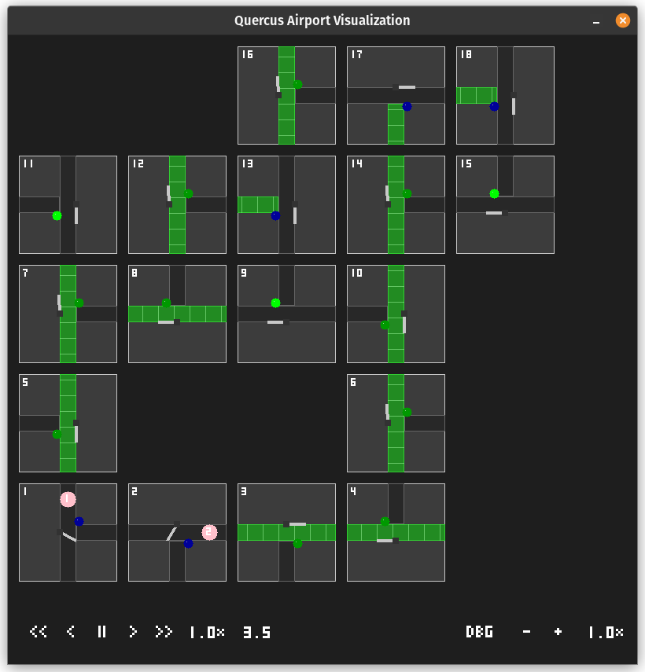

# Quercus Simulation

This repository contains the Quercus Airport Simulation. Read this file before you build or run the simulator.



## Repository Structure

```
simulation/
├── docs/                    # Architecture, protocol, and diagrams
├── editors/                 # LTLf editor support
├── q_sdk/                   # Pinned Quercus SDK submodule
├── src/                     # Simulator source code
├── test/                    # Unit, world, and applet tests
│   └── applets/             # Test applets, each with its scenarios
├── .clang-format            # C++ format rules
├── .gitlab-ci.yml           # GitLab CI job
├── .gitmodules              # Submodule locations
├── CMakeLists.txt           # Main build file
└── settings_example.toml    # Example run settings
```

## Build a world

Initialize the SDK submodule.

```sh
git submodule update --init
```

### The cosmocc bundle

The build uses the latest release of the project's cosmocc bundle, on Linux, macOS and Windows.
The bundle has everything that the build runs: clang and lld, CMake, Ninja, Python, west, git and a POSIX shell.
Nothing else needs to be installed.
Install the bundle with the installer of its release, as the [cosmocc README](https://gitlab.tue.nl/20223853/cosmopolitan-distribution-builder-test#installation-and-activation) describes.
Then activate it in each shell that builds the simulator:

| Shell | Command |
|---|---|
| bash, zsh | `. ~/.local/share/cosmocc/activate` |
| fish | `source ~/.local/share/cosmocc/activate.fish` |
| cmd | `%LOCALAPPDATA%\cosmocc\activate.bat` |
| PowerShell | `. $env:LOCALAPPDATA\cosmocc\activate.ps1` |

CMake must be the bundle's CMake: the build finds the toolchain through it.
On Linux, if Wine or Mono is registered with `binfmt_misc` for Windows executables, also register the APE loader, as the cosmocc README describes.

Get upstream Zephyr v4.5.0. Zephyr needs no changes: it builds the firmware with its own `host/llvm` toolchain, which is the bundle's clang once the bundle is activated.

```sh
git clone --depth 1 --branch v4.5.0 https://github.com/zephyrproject-rtos/zephyr ~/zephyrproject/zephyr
(cd ~/zephyrproject && west init -l zephyr)
export ZEPHYR_BASE=~/zephyrproject/zephyr
```

Zephyr does not support spaces in the paths of Zephyr or of an application, which includes this repository.
The bundle and the simulator's build directory can be anywhere.

Build the firmware objects of the test applets, as you would build any other Core 1 application.

```sh
cd test/applets
q_sdk/qbuild sim
cd ../..
```

Configure and build the simulator. The build uses cosmocc by default.

```sh
cmake -S . -B build -G Ninja
cmake --build build
```

### Host builds

On Linux, the simulator also builds with the host's clang and lld, LLVM 21 or later, without anything from cosmocc.
Configure with `CC=clang CXX=clang++` and `-DQSIM_COSMOCC=OFF`, in a separate build directory.
Build its firmware with `q_sdk/qbuild sim --toolchain host`, which writes the objects to `out/host/`.

`-DENABLE_SANITIZERS=ON` adds the undefined behaviour sanitizer, and in host builds also the address sanitizer. A finding stops the program, so that the test fails.

When you change the simulator core often, configure a separate build directory with `-DENABLE_LTO=OFF`.
A rebuild after one core edit then takes about half the time, and the unit tests run at the same speed.
Build worlds for measurements from an LTO build, which is the default.

Build a world from a layout. This layout puts the `conveyor` applet on one module.

```sh
cat > layout.toml <<'TOML'
firmware = "test/applets/out/conveyor.o"

[module.1]
active = true
neighbors = [0, 0, 0]
pos = [0, 0]
angle = 0
TOML
python3 build/qsim build layout.toml -o world.exe
```

A layout can set a default `firmware` path and override it for each module.
Firmware paths are relative to the layout.
The world build embeds the layout and one copy of the selected firmware for each active module.
A cosmocc world also gets a separate `world.exe.dbg` file.
The world embeds the SHA-256 digest of each firmware object for the attestation RPCs.
All simulated modules use the public test key with bytes `0x00` through `0x1f`.

## Run a scenario

Pass the scenario to the world executable.

```sh
./world.exe test/applets/conveyor/scenarios/route/scenario.toml
```

On macOS, use `sh ./world.exe` if the system does not start APE files directly.
A world can run compatible scenarios in separate invocations.
Use `--settings settings_example.toml` to supply runtime settings.
The world uses built-in defaults for each setting that the file omits.
If you omit `--settings`, the world uses built-in defaults for the entire run.
If the layout or firmware changes, build the world again.

The scenario runner returns 0 when all properties hold and 1 when a property fails or remains undecided.
It also returns 1 when firmware crashes or the simulation cannot finish, and 2 when its input is invalid.
After a firmware fault or watchdog timeout, the world stops that module and continues the scenario.
Keep the matching `world.exe.dbg` beside the executable for source lines in crash reports.
Set `QSIM_WATCHDOG_MS` to change the five-second grant watchdog limit. Set it to zero to disable the watchdog.

### Interactive runs

If the world can load SDL3, run the scenario with `--gui`.
A cosmocc world must contain SDL3 for the host platform. A host-compiler world loads the system's SDL3.

```sh
./world.exe test/applets/conveyor/scenarios/route/scenario.toml --gui --speed 2
```

`--speed` overrides the initial `simulation_speed` setting. A speed of `0` starts the simulation paused.
The GUI ignores `--timeout`. The scenario duration still limits assertion evaluation.
The simulation continues until you close the window or press Ctrl+C.

The [SDL3 workflow](.github/workflows/sdl3.yml) prepares the native libraries and their SHA-256 files.
Linux artifacts also contain a glibc loader helper and its SHA-256 file.
To embed SDL3, put the files from the matching artifact in a directory.
Set `QSIM_SDL3_ASSETS` to that directory when you configure CMake.
Without it, the world build uses `native/<os>-<cpu>` in the cosmocc toolchain if it exists, for example `native/linux-amd64`.
Then build the simulator and assemble the world. The world extracts the files to the user cache on a GUI run.
Intel macOS supports headless runs.

### Scenario files

Each scenario supplies `[scenario].duration`.
If the run needs assertions, set `properties` to an LTLf file relative to the scenario.
Put timed events in the scenario file. See [the tub arrivals example](test/applets/idle/scenarios/tub_arrivals/scenario.toml).
Set firmware variables in `[scenario.environment]`.
Firmware reads those variables and its own `QUERCUS_MODULE_ID` through `getenv`.
The simulator keeps the shell environment separate.

## Optimization

See [Build and measure optimized worlds](docs/OPTIMIZATION.md) for profile training and benchmarks.

## Tests

ctest runs three groups of tests. Their names start with the group.

| Group | Tests |
| --- | --- |
| `unit.<suite>` | One test for each GoogleTest suite of the simulator. |
| `world.<check>` | Checks of the world executable: repeatable traces and settings, the command line, and the GUI. |
| `applet.<applet>.<scenario>` | One test for each scenario of the [test applets](test/applets). `applet.build` builds the applets first. |

```sh
ctest --test-dir build -j --output-on-failure
```

Use `-L unit`, `-L world`, or `-L applet` to run one group, and `-R` to select tests by name.
To run single unit tests, pass a GoogleTest filter to the test executable, for example `build/tests.exe --gtest_filter='TraceEntry.*'`.
The world and applet tests need the Zephyr setup from [Build a world](#build-a-world).
`world.gui` reports that it skipped if the world cannot load SDL3. It uses the SDL3 dummy video driver.

### Applet scenarios

Each test applet in `test/applets/<applet>/` is an ordinary Core 1 application.
Its `scenarios/` directory holds one directory for each scenario, with these files:

| File | Contents |
| --- | --- |
| `scenario.toml` | The scenario. It can name a property file in the same directory. |
| `expected.txt` | One regular expression for each line. Each expression must match a whole line of the world's output, in the file's order. Blank lines and lines that start with `#` are comments. |
| `layout.toml` | Optional. A firmware value without a `/` is the name of a test applet. Without this file, one module runs the applet. |
| `args` | Optional. More command-line arguments for the world. |

The output is the world's standard output and standard error together, followed by `exit status: N`.
Escape regular expression characters to match text exactly: for example `\(`, `\.` and `\[`.
To see the output of a scenario, run it directly.

```sh
python3 test/run_scenario.py --verbose build/qsim test/applets/out test/applets/crash/scenarios/segfault
```

#### Test coverage

Generate an HTML coverage report with a Debug build. The report includes the code that the world and applet tests run.
Every test process writes its profile to `build-coverage/coverage/`.
The bundle's `llvm-profdata` and `llvm-cov` make the report.

```sh
cmake -S . -B build-coverage -G Ninja -DENABLE_COVERAGE=ON -DCMAKE_BUILD_TYPE=Debug
cmake --build build-coverage
ctest --test-dir build-coverage -j
llvm-profdata merge -o build-coverage/coverage.profdata build-coverage/coverage/*.profraw
llvm-cov show -format=html -output-dir=build-coverage/report -instr-profile=build-coverage/coverage.profdata \
    build-coverage/tests.exe.dbg -object build-coverage/qsim.o src
```

For a host build, add `-DQSIM_COSMOCC=OFF` and name `build-coverage/tests.exe` instead.

## Support

Create a GitLab issue if you find a problem. Use the provided issue format.

## Contributing

Contributions are welcome. A merge request must pass the format check and the applicable tests.

All C++ code must follow `.clang-format`. Add unit or integration tests for changes outside the visualization and `main.cpp`. Read `docs/ARCHITECTURE.md` and `docs/PROTOCOL.md` before you change the engine or its application interface.

## License

(c) Eindhoven University of Technology, Rens Verstappen, and contributors (2025-2026).

## Credits
Repository icons courtesy of [Magnific](https://www.magnific.com/) and [fancykeith](https://www.flaticon.com/authors/fancykeith).
