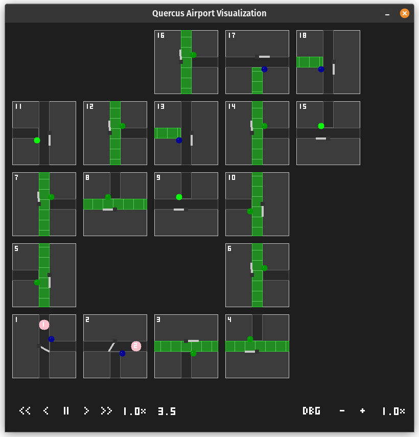

<!-- 
# TODO
**general**
- analyze implementing scheduler process that communicates to the router processes
- for hybrid mode send through pi, add separate interface for communication
- make id in events.toml 7 byte rfid
- remove server/client and fix tcp
- support going to planes

**event generator**
- total amount of tubs, density of tubs/planes
-->

# Quercus Simulation
The repository for the Quercus Airport Simulation. To avoid missing important information, please read the entire README before starting.



## Repository Structure

```
simulation/
├── .gitlab/                 # GitLab issue formats 
├── docs/                    # Architecture overview and diagrams
├── layouts/                 # Example layouts for use in settings.toml
├── src/                     # The source code
├── test/                    # All tests
├── .gitignore               # Ignored Git files
├── .gitlab-ci.yml           # GitLab CI runner details
├── events_example.toml      # Example event schedule input
├── layout_example.toml      # Example layout
├── README.md                # Project overview
├── settings_example.toml    # Example simulator configuration input
└── CMakeLists.txt           # Main build script for the application and tests
```

## Requirements
**Installation**
- Ubuntu 24 or higher / Debian 13 or higher
- Internet connection

**Usage**
- Ubuntu 24 or higher / Debian 13 or higher

## Installation
1. Run `sudo apt-get install git build-essential libsdl2-dev ninja-build`.
1. Clone the router repo locally. Set up West and Zephyr, as described **[here](https://gitlab.tue.nl/2irr70-capstone-quercus-airport/quercus_platform_pico2#environment-setup-ci-compatible-baseline)**. If done correctly, you should be able to build a native `zephyr.exe` file using the run/build script present. This file is usually found at `build/zephyr/zephyr.exe`.
1. Clone this repo locally. 
1. Copy `events_example.toml` and rename it to `events.toml`. Do the same for `settings_example.toml` to `settings.toml` and `layout_example.toml` to `layout.toml`.
1. Change the `router_path` value in the settings to the absolute path of the `zephyr.exe` executable. The absolute path should look similar to this: `/home/user/airport-router/build/zephyr/zephyr.exe`.
1. Run `cmake -B build -S . -G Ninja`.

## Usage
Run the project with the `Run` button when using the C/C++ VSCode extension, or use the following command in the project folder: 

```sh
cmake --build build -j && ./build/simulation
```

This will start all modules and run the current events in the `events.toml` file until infinity. Settings can be changed by pressing the buttons at the bottom. Closing the GUI stops the simulation and all modules. Changes to the `events.toml` or `settings.toml` files will only apply after restarting the simulation by closing the GUI and re-running the project as described above.

To run the tests, change the target to `tests` when using the C/C++ VSCode extension, or use the following command in the project folder:

```sh
cmake --build build -j && ./build/tests
```

To calculate test coverage, you must first install lcov. Then, run the following commands and open the webpage at `build/coverage_html/index.html`:

```sh
cmake -B build -DENABLE_COVERAGE=ON -DCMAKE_BUILD_TYPE=Debug -S . -G Ninja
cmake --build build --target tests -j
./build/tests
cd build
lcov --capture --directory . --output-file coverage.info --ignore-errors gcov,gcov
lcov --remove coverage.info '/usr/*' '*/_deps/*' '*/test/*' --output-file coverage_filtered.info
genhtml coverage_filtered.info --output-directory coverage_html
cd ..
cmake -B build -S . -G Ninja
```

Last measured test coverage: 59.0% of lines and 67.4% of functions on 27-06-2026.

## Support
In case you encounter any problems, create an issue on GitLab. Please use the provided issue format.

## Contributing
If you make improvements to the digital simulation for your project, you are free to contribute these changes to this repo. Any merge requests will be thoroughly reviewed before merging, so make sure you are willing to change your code before opening a merge request.

## License
(c) Eindhoven University of Technology, Rens Verstappen, and contributors (2025-2026).
