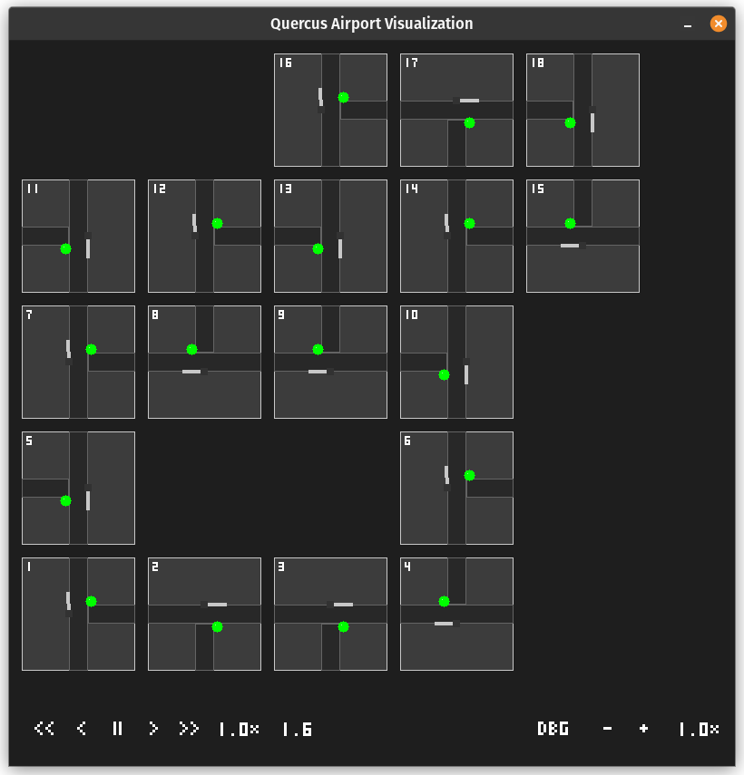
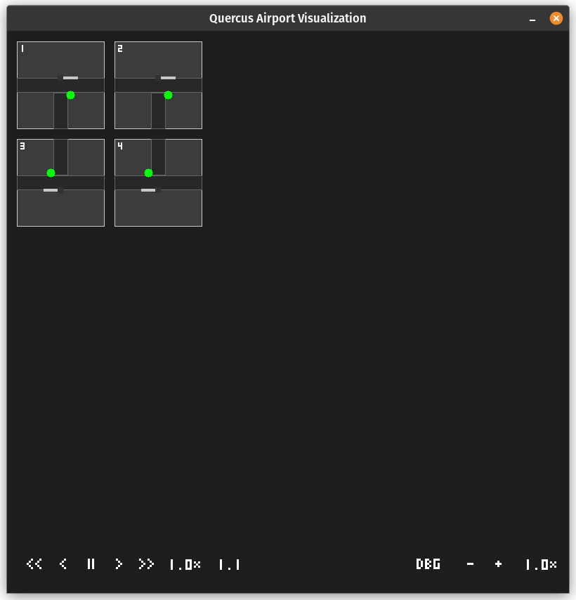
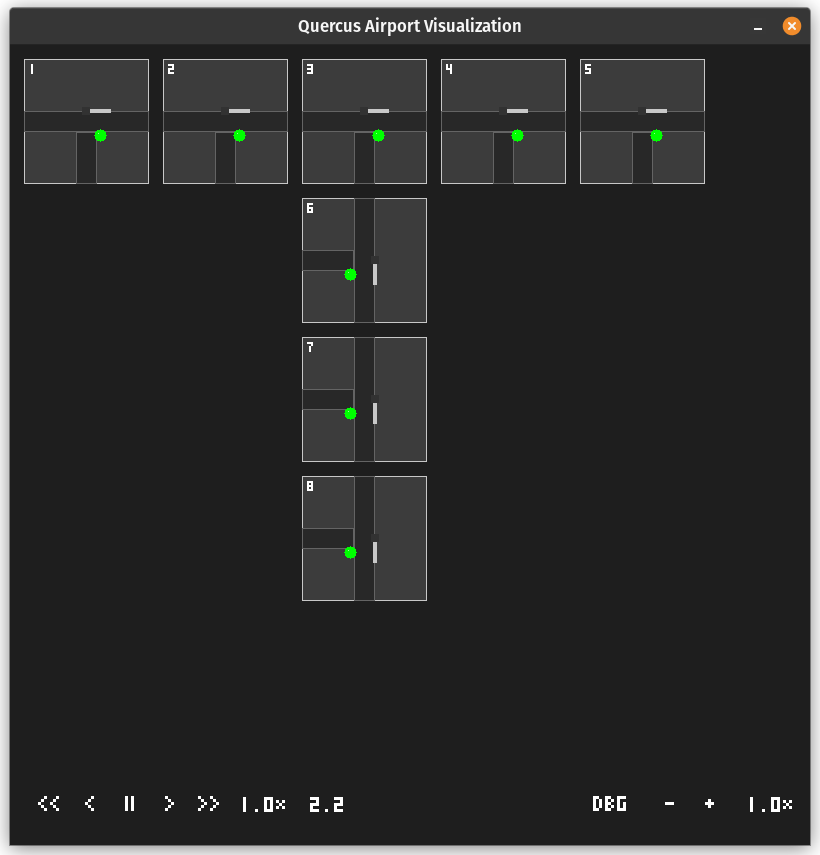

# Simulation Layouts

This folder contains example layouts which you can use for testing.

### Default

The default layout.

### Small

Ideal for testing specific features.

### Bottleneck

An example of a worst-case scenario layout.

